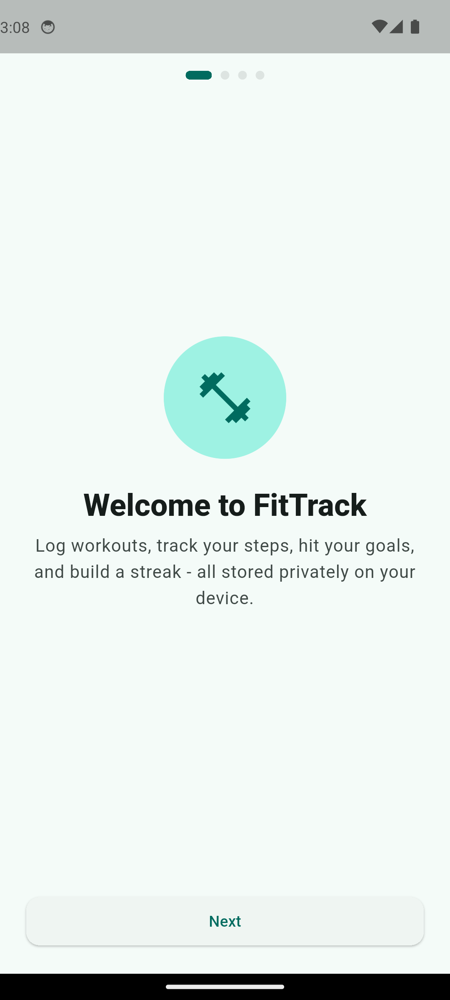
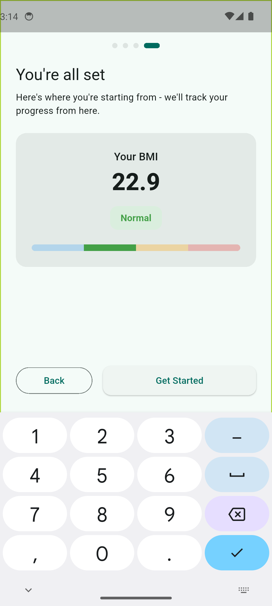
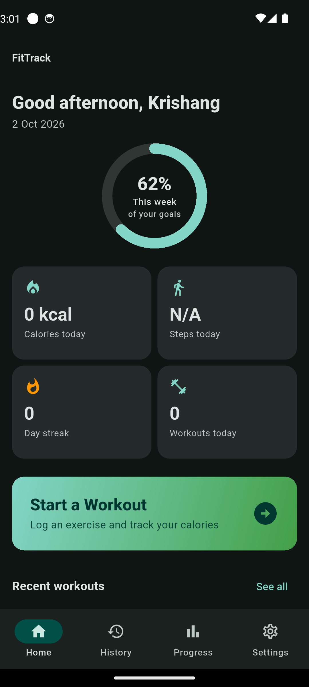
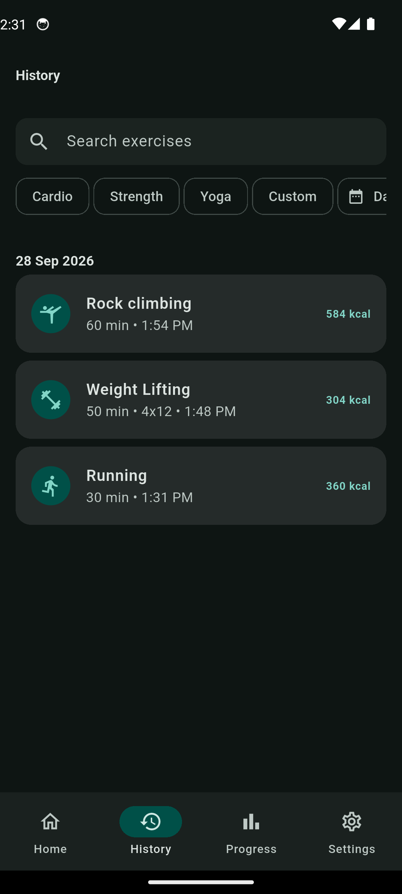
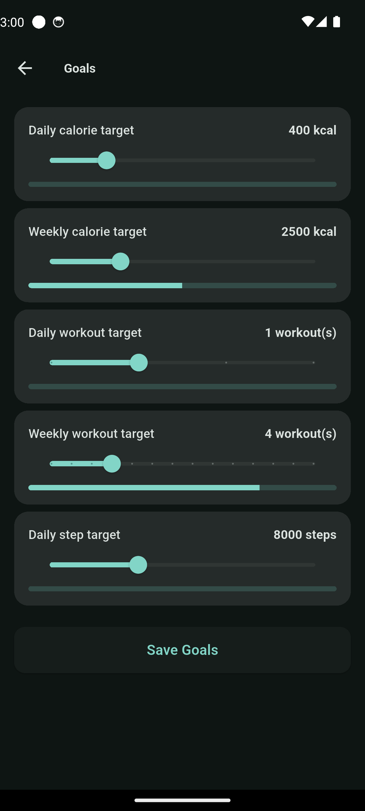
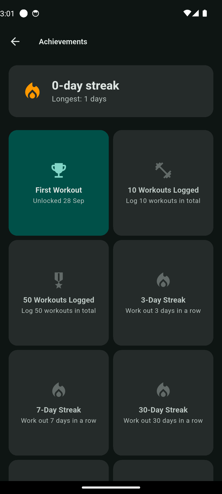
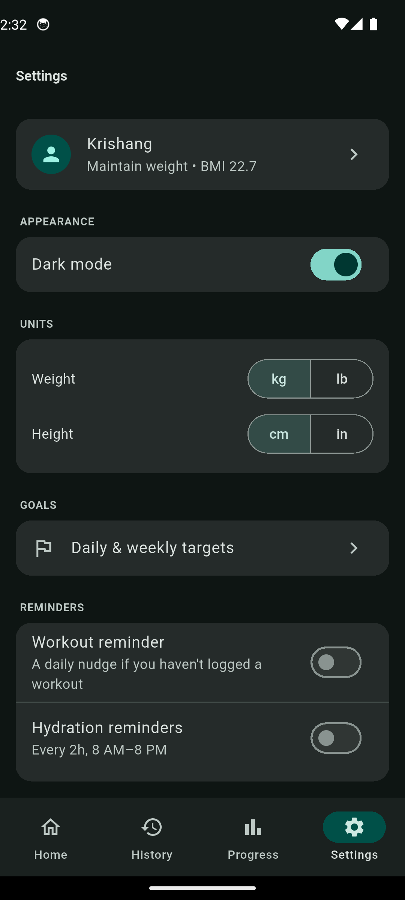

# FitTrack

A local-first Gym Fitness Tracker built with Flutter for Android. Log
workouts, track calories via the MET formula, watch your live step count,
build a streak, unlock achievements, and chart your progress over time — all
stored entirely on-device, with no backend and no account required.

Built as a Mobile Application Development mini-project, designed to also be
genuinely usable day-to-day.

## Features

- **Onboarding** — collects name, age, height, weight, gender and fitness
  goal (lose / maintain / gain), computes BMI and WHO category on the spot.
- **Dashboard** — animated weekly-goal progress ring, today's calories,
  live step count, current streak, quick "Start Workout" action, and a
  preview of recent workouts.
- **Workout logging** — cardio / strength / yoga / custom exercise types,
  sets & reps for strength, duration, notes, and a live calorie estimate
  using the MET formula as you type. Full edit/delete support.
- **Goals** — daily & weekly calorie, workout-count and step targets, with
  live progress bars.
- **Progress charts** (fl_chart) — weight trend, weekly calories bar chart,
  and BMI history with WHO-category band shading.
- **Streaks & achievements** — consecutive-day streak counter and 8
  unlockable badges (first workout, 10/50 workouts, 3/7/30-day streaks,
  5,000 kcal lifetime, 10k steps in a day).
- **Local notifications** — a daily workout reminder and configurable
  hydration reminders, scheduled in the device's real timezone and
  surviving reboots.
- **Live step counter** — via the device pedometer, with a stored daily
  baseline so it survives app restarts and device reboots.
- **Workout history** — searchable, filterable by exercise type and date
  range, grouped by day, swipe-to-delete with undo.
- **Settings** — dark mode, kg/lb and cm/in unit switches, edit profile,
  and a reset-all-data option.

## Architecture

Local-first, layered architecture with **plain Riverpod** (no code
generation — every provider is explicit and readable):

```
Presentation   lib/screens, lib/widgets        (ConsumerWidget / Consumer­StatefulWidget)
      │  ref.watch / ref.read
State          lib/providers                   (Provider, StateProvider, StateNotifierProvider, StreamProvider)
      │
Repository     lib/repositories                (typed domain API, no SQL above this layer)
      │
Data source    lib/data/app_database.dart      (sqflite: schema, indexes, migrations)
Services       lib/services                    (notifications, pedometer, permissions)
Pure logic     lib/utils                       (BMI/calorie/streak/achievement calculators — unit-tested)
```

```
lib/
  main.dart, app.dart        # Startup wiring + theming/routing gate
  data/                      # sqflite schema + connection
  models/                    # Immutable data classes (toMap/fromMap/copyWith)
  repositories/              # CRUD + aggregate queries per table
  services/                  # Platform wrappers: notifications, pedometer, permissions
  providers/                 # Riverpod state, one file per feature area
  screens/                   # One folder per screen, with a widgets/ subfolder for its parts
  widgets/                   # Shared widgets (common/, dashboard/, workout/, progress/)
  utils/                     # constants.dart, theme.dart, calculators, date/validation helpers
test/                        # Unit tests for calculators + a widget test for the progress ring
```

### Database schema (sqflite, version 1)

| Table | Purpose |
|---|---|
| `user_profile` | Single row: personal details + latest BMI |
| `workouts` | Every logged session (indexed on `performed_at`, `type`) |
| `weight_logs` | Weight + BMI at each check-in — feeds both trend charts |
| `goals` | Single row: daily/weekly calorie, workout and step targets |
| `achievements` | Unlocked badge codes + timestamps (definitions live in code) |
| `step_logs` | Per-day step count + sensor baseline, so today's count survives a restart |

App-wide preferences (theme, units, reminder config) live in
`SharedPreferences`, separate from the fitness data in sqflite.

## Setup

1. Install Flutter 3.47.x (stable) and the Android SDK (compileSdk/targetSdk
   35). Run `flutter doctor` and resolve anything unchecked for Android.
   minSdk is left as `flutter.minSdkVersion` (currently API 24 / Android 7.0)
   rather than hardcoded lower - see *Known limitations* below.
2. From the `fittrack/` directory:
   ```
   flutter pub get
   flutter test        # unit tests for BMI/calorie/streak/achievement logic
   flutter analyze      # should report no issues
   flutter run           # or: flutter build apk --debug
   ```
3. On first run, grant the Activity Recognition (steps) and Notifications
   permissions when prompted for the full experience — the app degrades
   gracefully (shows "N/A" / friendly empty states) if they're declined.

### Regenerating the launcher icon / splash screen

The teal→green dumbbell icon and splash are generated from source images in
`assets/icon/` and `assets/splash/` via dev-only tooling (not shipped in the
app). After changing those source images:
```
dart run flutter_launcher_icons
dart run flutter_native_splash:create
```

## Known limitations / future scope

- **Minimum Android version**: the original target was API 21 (Android 5.0),
  but Flutter 3.47's engine no longer builds below API 24 (Android 7.0) - the
  Flutter Gradle plugin auto-rewrites any hardcoded lower value on every
  build for exactly that reason (`MinSdkVersionMigration` in flutter_tools).
  `android/app/build.gradle.kts` uses `flutter.minSdkVersion` accordingly.
  Every plugin this app uses (sqflite, pedometer, permission_handler,
  flutter_local_notifications, flutter_timezone) individually supports API
  16–19, so the actual floor is entirely Flutter's own, not this app's.

Everything above works fully offline, on-device. These would need a backend
to go further — a natural "future scope" list for a viva:

- **Cloud sync / backup** — data lives only on one device; reinstalling or
  switching phones loses it. Needs an account system + cloud database.
- **Social features** — friend leaderboards, shared challenges, sharing a
  workout — needs a backend to model relationships between users.
- **Wearable integration** — syncing with a smartwatch/fitness band for
  richer sensor data (heart rate, GPS-based distance) instead of just the
  phone's step counter.
- **AI-generated workout plans** — personalized programs based on history
  and goals would need a server-side model rather than on-device rules.
- **Multi-device continuity** — starting a workout on one device and
  finishing on another requires server-mediated state.
- **Exact alarm scheduling** on some OEM Android skins may still delay
  notifications a few minutes under aggressive battery optimization; the
  app requests the exact-alarm permission but falls back to inexact
  scheduling if it's denied.
- The step counter has no data on emulators (no virtual step sensor) — the
  dashboard shows a graceful "unavailable" state there; test it on a real
  device for live values.

## Screenshots

| Onboarding | BMI result | Dashboard |
|---|---|---|
|  |  |  |

| History | Goals | Achievements |
|---|---|---|
|  |  |  |

| Settings |
|---|
|  |
